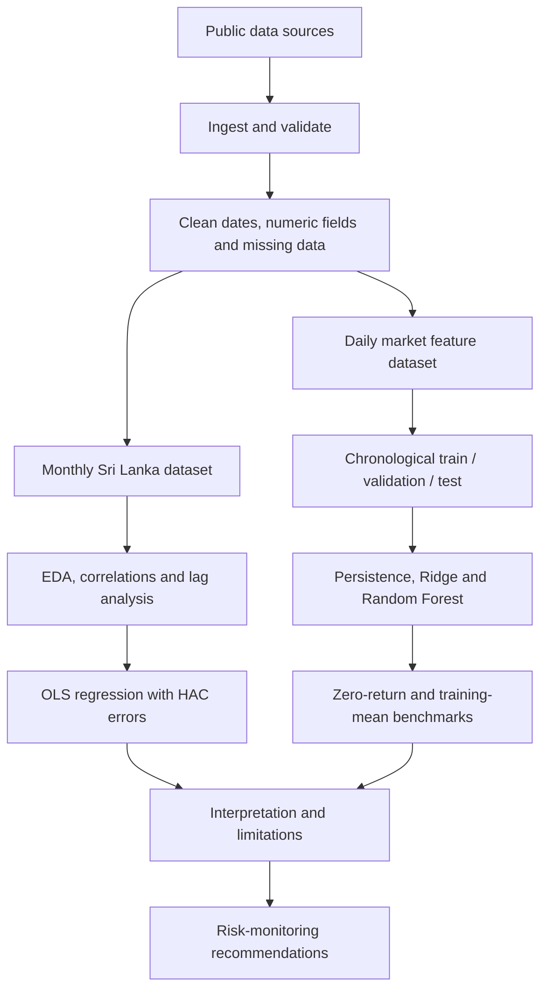

# 🛢️ 🪙 Gold, Oil & the Cost of Living in Sri Lanka

### A data-science investigation of commodity markets, exchange rates, inflation, and short-horizon oil-price risk

**[Explore the repository](https://github.com/Deathbot545/Gold_Oil_Cost_of_Living_COMPLETE_Coursework_Notebook)** · **[Open Google Colab](https://colab.research.google.com/)**

---

## 🌍 Why this project?

In an import-dependent economy, changes in the **USD/LKR exchange rate** and **international oil markets** may matter for household purchasing power and business costs. This project explores how those indicators move alongside Sri Lankan inflation, then asks a second, related question: can information from oil and gold *volatility* markets help forecast the next observed Brent oil-price return?

> **Important distinction:** This notebook contains **two related analyses**, not a single model. The monthly regression work studies **Sri Lankan inflation associations**; the daily machine-learning work predicts **Brent oil returns**, **not Sri Lankan inflation**.

## 🎯 Research questions

1. How are monthly changes in the **USD/LKR exchange rate** and **Brent crude prices** associated with month-on-month **CCPI** and **NCPI** inflation in Sri Lanka?
2. Do **time lags** change those observed relationships, and how sensitive are the results to the 2022 crisis period?
3. Can **Ridge regression** or **Random Forest** outperform simple benchmarks when estimating the **next available Brent return**?

## 🧭 Project workflow

## 📊 Datasets

| Source | Variables / role | Frequency |
|---|---|---|
| [FRED](https://fred.stlouisfed.org/) | Brent (`DCOILBRENTEU`), WTI (`DCOILWTICO`), oil volatility (`OVXCLS`), gold volatility (`GVZCLS`) | Daily observations |
| [DataHub Gold Prices](https://datahub.io/core/gold-prices) | Gold price in USD per troy ounce | Monthly |
| [Central Bank of Sri Lanka](https://www.cbsl.gov.lk/) | USD/LKR telegraphic-transfer buying and selling rates | Daily observations |
| [Department of Census and Statistics](https://www.statistics.gov.lk/) | CCPI and NCPI price indices | Monthly |
| [Ceylon Petroleum Corporation](https://ceypetco.gov.lk/) | Domestic fuel-price revision records | Event-based |

**Data coverage in the saved notebook:**

- **10,661** rows in the full-history joined international market table (1986-01-02 to 2026-11-12); many early values are missing because the series start at different times.
- **2,925** dates have all four international market indicators observed.
- **57** aligned monthly observations (January 2022–September 2026) for the Sri Lankan inflation study; month-on-month comparisons use the available sequential changes.
- **2,922** engineered daily modelling rows with **11 predictors** for Brent return estimation.

## 🧪 Methods

**Monthly economic analysis:** date alignment, monthly averages, percentage changes, Pearson/Spearman correlations, 0–6-month exploratory lag checks, OLS regression with heteroskedasticity/autocorrelation-consistent (**HAC**) standard errors, influence tests, residual diagnostics, and comparisons of full-period versus post-2022 results.

**Daily forecasting benchmark:** a chronological **70% / 15% / 15%** train/validation/test split, a persistence baseline, **scaled Ridge regression**, **Random Forest regression**, and stronger **zero-return** and **training-mean** baselines. Evaluation uses **MAE**, **RMSE**, and **R²** on held-out test observations.

## 🔎 Selected findings

### Monthly Sri Lankan inflation

- The initial full-period regression fits were **R² = 0.5961 (CCPI)** and **0.6811 (NCPI)**.
- Excluding 2022 reduced those lag-1-model values to **0.2116 (CCPI)** and **0.1574 (NCPI)**, illustrating the influence of the crisis period.
- **Lagged USD/LKR movement** had a positive, statistically significant coefficient in the main fitted regression specifications.
- An exploratory **three-month Brent lag** improved some model-fit comparisons versus a one-month lag. Because the lag was selected after exploring the data, it is **not proof of a fixed causal delay**.

### Next-observation Brent return forecasting

| Test-set method | MAE (percentage points) | RMSE (percentage points) | R² |
|---|---:|---:|---:|
| **Training-mean forecast** | **2.4051** | **3.4843** | **≈ 0.0000** |
| Zero-return forecast | 2.4011 | 3.4861 | -0.0011 |
| Ridge regression | 2.4864 | 3.5406 | -0.0326 |
| Random Forest | 2.5539 | 3.7045 | -0.1305 |
| Naive persistence | 3.4773 | 5.0331 | -1.0867 |

**Takeaway:** Ridge beats the *persistence* baseline but does **not** outperform simpler constant forecasts on test RMSE. The negative test R² values for both machine-learning models mean the notebook **does not demonstrate reliable next-observation forecasting skill**.

## 🛠️ Technology

- **Python / Google Colab** — interactive analysis and execution
- **pandas, NumPy** — cleaning, merging, aggregation, feature engineering
- **requests, pdfplumber** — retrieving and parsing public sources
- **Matplotlib** — exploratory and diagnostic visualisations
- **statsmodels / SciPy** — statistical regressions and diagnostics
- **scikit-learn** — preprocessing, Ridge and Random Forest

## 🚀 Reproducing the analysis

1. Open the `.ipynb` notebook in **Google Colab**.
2. Create the Google Drive folder **`MyDrive/Gold_Oil_Cost_of_Living/`**.
3. Place these original input files in that folder: **`OVXCLS.csv`**, **`GVZCLS.csv`**, **`DCOILBRENTEU.csv`**, **`DCOILWTICO.csv`**, and **`IF_Buying_Selling_Exchange_Rates.xlsx`**. The exchange-rate workbook's sheet/format must match what the notebook expects.
4. Install dependencies using the notebook's opening cells, then mount Google Drive.
5. Run cells **in order** and review PDF/API extraction checks. Some live external sources may change their layouts or available dates.
6. Inspect the final regression tables, model comparisons, supplementary audits, and CSV exports in the Drive folder.

**Note:** The `.ipynb` file contains saved output snapshots but **not** the required raw files stored in the author's Google Drive. Publishing the notebook alone is not a fully reproducible data package.

## ⚠️ Research limitations

- **Association ≠ causation.** Exchange rates, inflation and oil prices can all react to wider economic events and policy changes.
- The monthly sample is comparatively short and influenced by **2022**; results are sensitive to model specification and period.
- Only a fraction of the 10,661 historical rows contain all four market indicators; the daily model is therefore based mainly on later dates.
- Oil returns have extreme observations and regime changes. A one-step forecast may span **multiple calendar days** because of weekends and holidays.
- The chronological split audit flags **one target crossing each train/validation and validation/test boundary**; future modelling should purge these overlaps and use rolling-origin validation.
- The original source files, exact download dates and permissions should be documented before sharing a fully reproducible release.

## 💡 Practical implications

The strongest recommendation is a **transparent monitoring dashboard** and conservative **FX/oil scenario planning**, not an automated commodity trading system. Future work could include cleaned public data packaging, purged rolling-window evaluation, better release-time alignment, and a separately designed **monthly inflation forecasting** model.

## 📚 Selected source references

- [FRED — Brent](https://fred.stlouisfed.org/series/DCOILBRENTEU) · [WTI](https://fred.stlouisfed.org/series/DCOILWTICO) · [OVX](https://fred.stlouisfed.org/series/OVXCLS) · [GVZ](https://fred.stlouisfed.org/series/GVZCLS)
- [DataHub — Gold Prices](https://datahub.io/core/gold-prices)
- [Central Bank of Sri Lanka](https://www.cbsl.gov.lk/) · [Department of Census and Statistics](https://www.statistics.gov.lk/) · [Ceylon Petroleum Corporation](https://ceypetco.gov.lk/)

---

*An academic data-science project focused on reproducible analysis, honest evaluation and evidence-based interpretation.*

